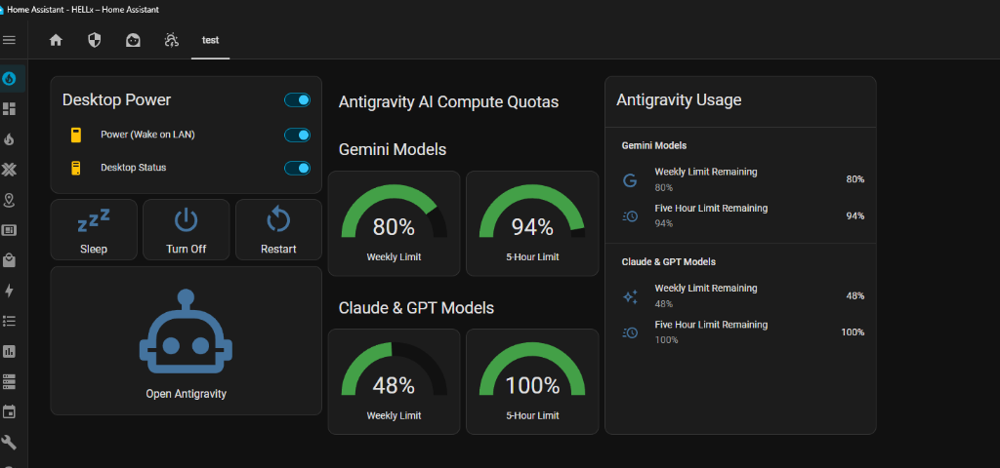
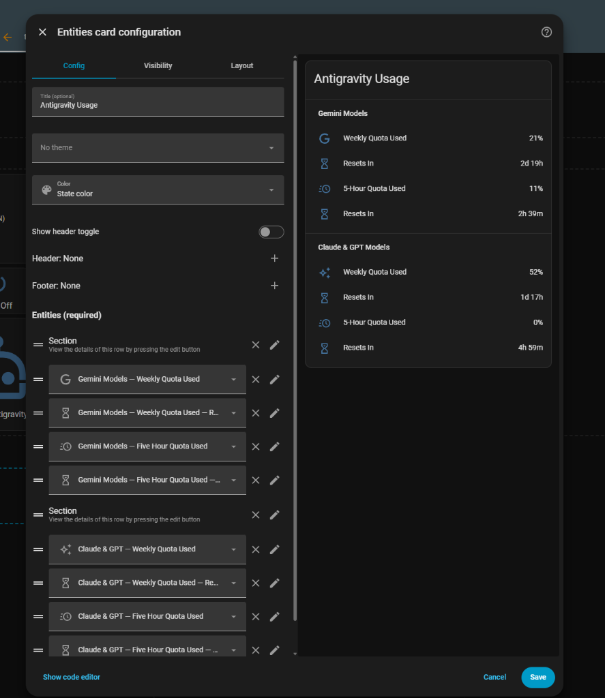

# Antigravity & Gemini Usage Monitor for Home Assistant 🚀

> [!IMPORTANT]
> 🍸 **100% Vibe Coded — Zero Human-Written Code**:  
> The human author ([@brunopatuleia](https://github.com/brunopatuleia)) conceived the idea, directed the design, and tested the integration while relaxing and having drinks — but **did not write a single line of code**.
> 
> 🤖 **AI Agents & Models Used**:
> * **Google DeepMind Antigravity**: Autonomous agent platform, CLI orchestration, and local daemon integration.
> * **Google Gemini**: Gemini 3.8 Flash (High), Gemini 2.5 Flash, and Gemini 2.5 Pro.
> * **Anthropic Claude**: Claude Opus 5.5 (High), Claude 3.7 Sonnet, and Claude 3.5 Sonnet (via Antigravity).
> 
> Every single line of code — from architecture, Home Assistant async coordinators, daemon reverse-engineering, REST state synchronization, and systemd units to Lovelace cards and documentation — was **100% generated, debugged, and implemented by AI**. Use at your own discretion, inspect with curiosity, and community PRs / improvements are warmly welcomed!

[](https://github.com/hacs/default)
[](https://github.com/brunopatuleia/ha_gemini_usage/releases)
[](https://opensource.org/licenses/MIT)

<p align="center">
  
</p>

A real-time monitor for **Google Antigravity** compute limits and **Google Gemini API** quotas in Home Assistant.

---

## 🌟 What Does This Monitor?

### 1. Antigravity Compute Quotas (No Google API key required!)
Monitors your active **Google Antigravity** dual-tier rolling compute capacity:
* **Gemini Models**: Weekly Limit & 5-Hour rolling refresh window
* **Claude & GPT Models**: Weekly Limit & 5-Hour rolling refresh window
* **Live Reset Timers**: Countdown to reset (e.g., `Resets in 2d 19h` or `3h 16m`)
* **Two Display Styles**: 
  * **Quota Used (Increasing)**: 0% $\rightarrow$ 100% (fills up like CPU/RAM usage)
  * **Quota Remaining (Decreasing)**: 100% $\rightarrow$ 0% (depletes like a battery)

### 2. Google AI Studio Developer API *(Optional HACS Component)*
For developers using raw Gemini API keys (`AIzaSy...`):
* Dynamic model catalogue discovery (`GET /v1beta/models`)
* Model context windows and token output ceilings
* API health and round-trip HTTP latency

---

## ⚡ Quick Start: Antigravity Real-Time Quota Monitor

You **do not need HACS** to use the Antigravity Quota Monitor. It runs on the computer where Antigravity is installed and streams live sensors directly into Home Assistant via its native REST API.

### Step 1: Get a Home Assistant Long-Lived Access Token
1. Open your Home Assistant dashboard in your browser.
2. Click your **User Profile** icon in the bottom-left corner.
3. Select the **Security** tab (or scroll down to **Long-Lived Access Tokens**).
4. Click **Create Token**, name it `Antigravity`, and copy the token string (`eyJhbGciOi...`).

### Step 2: Configure Your Environment
1. Clone this repository on the machine running Antigravity:
   ```bash
   git clone https://github.com/brunopatuleia/ha_gemini_usage.git
   cd ha_gemini_usage
   ```
2. Copy the example configuration file:
   ```bash
   cp .env.example .env
   ```
3. Edit `.env` with your Home Assistant details:
   ```ini
   # Home Assistant URL (local IP, homeassistant.local, or Nabu Casa)
   HA_URL=http://192.168.1.240:8123

   # Paste the Long-Lived Access Token created in Step 1
   HA_TOKEN=eyJhbGciOiJIUzI1NiIsInR5cCI6IkpXVCJ9...

   # Sync interval in seconds (default: 60)
   SYNC_INTERVAL=60
   ```

### Step 3: Run the Sync Service

#### Test it once:
```bash
python3 sync_antigravity_quota.py --once
```
You should see:
```text
[INFO] Successfully synced 36 Antigravity quota sensors to Home Assistant.
```

#### Run permanently as a background service (Linux / systemd):
```bash
# Copy service definition to your user systemd directory
mkdir -p ~/.config/systemd/user
cp antigravity-ha-sync.service ~/.config/systemd/user/

# Enable and start service
systemctl --user daemon-reload
systemctl --user enable antigravity-ha-sync.service
systemctl --user start antigravity-ha-sync.service
```

---

## 📊 Live Home Assistant Entities & Unique IDs

All sensors are registered with native **Unique IDs** and grouped under the **Google Antigravity** device in Home Assistant's Entity Registry. This means you can:
* Manage them directly in the Home Assistant UI without warnings.
* Assign them to Areas (e.g. *Office* or *Developer Lab*).
* Customize friendly names, icons, and display precision right from the UI.
* View complete historical graphs, states, and long-term statistics.

### Primary Entities (Configurable Mode)
These entities dynamically adapt their state and label to your display preference:

| Entity ID | Friendly Name | Default Metric | Description |
| :--- | :--- | :---: | :--- |
| `sensor.antigravity_gemini_weekly` | Gemini Models — Weekly Quota Used | **Used %** | Weekly compute used by Gemini Flash / Pro |
| `sensor.antigravity_gemini_5h` | Gemini Models — Five Hour Quota Used | **Used %** | 5-Hour rolling compute used by Gemini |
| `sensor.antigravity_claude_gpt_weekly` | Claude & GPT — Weekly Quota Used | **Used %** | Weekly compute used by Claude Opus / Sonnet / GPT |
| `sensor.antigravity_claude_gpt_5h` | Claude & GPT — Five Hour Quota Used | **Used %** | 5-Hour rolling compute used by Claude / GPT |
| `sensor.antigravity_quota_status` | Antigravity Quota Status | `Online` | Connection status and sync heartbeat |
| `sensor.antigravity_version` | Antigravity Integration Version | `1.1.0` | Installed release version and diagnostics |

---

## ⚖️ Quota Display Modes: Google Way vs. Your Way

Google presents quotas as **Remaining %** (decreasing from 100% $\rightarrow$ 0%, like a battery). Many developers prefer **Used %** (increasing from 0% $\rightarrow$ 100%, like CPU/RAM usage).

**Do you have to choose between a single entity or both? You get BOTH!**

1. **Option A: Single Configurable Entity (UI Dropdown)**
   * In Home Assistant, go to **Settings > Devices & Services > Gemini Usage Monitor > Configure**.
   * Select your preferred **Antigravity Quota Display Mode**:
     * **Increasing (0% → 100% Used)** — *The user's preferred style!*
     * **Decreasing (100% → 0% Remaining)** — *Google's default style!*
   * Your primary sensors (`sensor.antigravity_gemini_weekly`, etc.) immediately switch values and icons, meaning you never need to edit your dashboard cards if you change your mind!

2. **Option B: Dedicated Entities Available Simultaneously**
   If you want to display BOTH on your dashboard at the same time (e.g., a Gauge for Used % and a secondary stat for Remaining %), both explicit entities are always published:
   * **Used % Sensors (Always 0% → 100%)**:
     * `sensor.antigravity_gemini_weekly_used`
     * `sensor.antigravity_gemini_5h_used`
     * `sensor.antigravity_claude_gpt_weekly_used`
     * `sensor.antigravity_claude_gpt_5h_used`
   * **Remaining % Sensors (Always 100% → 0%)**:
     * `sensor.antigravity_gemini_weekly_remaining`
     * `sensor.antigravity_gemini_5h_remaining`
     * `sensor.antigravity_claude_gpt_weekly_remaining`
     * `sensor.antigravity_claude_gpt_5h_remaining`
   * **Reset Countdown Sensors**:
     * `sensor.antigravity_gemini_weekly_resets_in` (e.g. `2d 18h`)
     * `sensor.antigravity_gemini_5h_resets_in` (e.g. `2h 25m`)
     * `sensor.antigravity_claude_gpt_weekly_resets_in` (e.g. `1d 17h`)
     * `sensor.antigravity_claude_gpt_5h_resets_in` (e.g. `Now` or `4h 59m`)

---

## 🔮 Predictive Pace & Quota Runway Engine (Will You Exceed Your Quota?)

Deep in a coding sprint? The integration features a **Predictive Consumption & Runway Engine** that analyzes your real-time coding pace and forecasts whether you are on track to surpass your quota before the window resets.

### How the Prediction Works:
1. **Live Burn Rate (Velocity)**: Calculated as $\frac{\text{Used } \%}{\text{Elapsed Hours}}$ (e.g. `6.8 %/h`).
2. **Projected Usage at Reset**: Computes where your quota will land when the reset occurs (e.g. `34%` = Safe, `120%` = Will Exhaust!).
3. **Runway**: Estimates how many hours of coding you have left until 100% exhaustion at your current pace (e.g. `11h 51m`).
4. **Over-Quota Risk Binary Sensor**: Instantly turns `on` (`Problem` state) when your current burn rate predicts quota exhaustion before the window refreshes.

### Predictive Entities:

| Entity ID | Friendly Name | Type | Example State |
| :--- | :--- | :---: | :--- |
| `sensor.antigravity_gemini_5h_burn_rate` | Gemini 5h — Burn Rate | Sensor | `6.8 %/h` |
| `sensor.antigravity_gemini_5h_projected` | Gemini 5h — Projected at Reset | Sensor | `34.0 %` |
| `sensor.antigravity_gemini_5h_runway` | Gemini 5h — Runway | Sensor | `11h 51m` |
| `sensor.antigravity_gemini_5h_pace` | Gemini 5h — Pace Status | Sensor | `Safe` / `Elevated` / `High Risk (Over Quota)` |
| `binary_sensor.antigravity_gemini_5h_over_quota_risk` | Gemini 5h — Over-Quota Risk | Binary Sensor | `off` (Safe) / `on` (Warning: Problem!) |
| `sensor.antigravity_claude_gpt_weekly_burn_rate` | Claude/GPT Weekly — Burn Rate | Sensor | `0.41 %/h` |
| `sensor.antigravity_claude_gpt_weekly_projected` | Claude/GPT Weekly — Projected | Sensor | `69.0 %` |
| `sensor.antigravity_claude_gpt_weekly_runway` | Claude/GPT Weekly — Runway | Sensor | `4d 20h` |
| `binary_sensor.antigravity_claude_gpt_weekly_over_quota_risk` | Claude/GPT Weekly — Over-Quota Risk | Binary Sensor | `off` / `on` |


## 📈 Home Assistant Dashboard Cards

### 1. Detailed Entities List with Countdown Timers (Visual Editor Ready)
Shows both your consumed percentage and the live reset countdown (`Resets In`), fully compatible with Home Assistant's UI visual editor:

<p align="center">
  
</p>

```yaml
type: entities
title: Antigravity Usage
show_header_toggle: false
entities:
  - type: section
    label: Gemini Models
  - entity: sensor.antigravity_gemini_weekly
    name: Weekly Quota Used
  - entity: sensor.antigravity_gemini_weekly_resets_in
    name: Resets In
  - entity: sensor.antigravity_gemini_5h
    name: 5-Hour Quota Used
  - entity: sensor.antigravity_gemini_5h_resets_in
    name: Resets In

  - type: section
    label: Claude & GPT Models
  - entity: sensor.antigravity_claude_gpt_weekly
    name: Weekly Quota Used
  - entity: sensor.antigravity_claude_gpt_weekly_resets_in
    name: Resets In
  - entity: sensor.antigravity_claude_gpt_5h
    name: 5-Hour Quota Used
  - entity: sensor.antigravity_claude_gpt_5h_resets_in
    name: Resets In
```

---

### 2. Visual Circular Gauges (Color Severity)
Circular radial gauges with color severity thresholds (Green for low usage, Yellow for moderate, Red when near quota):

```yaml
type: vertical-stack
title: Antigravity AI Compute Quotas
cards:
  - type: grid
    title: Gemini Models
    columns: 2
    square: false
    cards:
      - type: gauge
        entity: sensor.antigravity_gemini_weekly
        name: Weekly Limit
        min: 0
        max: 100
        severity:
          green: 0
          yellow: 70
          red: 90
      - type: gauge
        entity: sensor.antigravity_gemini_5h
        name: 5-Hour Limit
        min: 0
        max: 100
        severity:
          green: 0
          yellow: 70
          red: 90

  - type: grid
    title: Claude & GPT Models
    columns: 2
    square: false
    cards:
      - type: gauge
        entity: sensor.antigravity_claude_gpt_weekly
        name: Weekly Limit
        min: 0
        max: 100
        severity:
          green: 0
          yellow: 70
          red: 90
      - type: gauge
        entity: sensor.antigravity_claude_gpt_5h
        name: 5-Hour Limit
        min: 0
        max: 100
        severity:
          green: 0
          yellow: 70
          red: 90
```

---

### 3. Minimalist Entities List (Without Gauges, Clean Percentages)
A clean, compact list displaying only the percentages with zero clutter:

```yaml
type: entities
title: Antigravity Usage
show_header_toggle: false
entities:
  - type: section
    label: Gemini Models
  - entity: sensor.antigravity_gemini_weekly
    name: Weekly Quota Used
  - entity: sensor.antigravity_gemini_5h
    name: 5-Hour Quota Used

  - type: section
    label: Claude & GPT Models
  - entity: sensor.antigravity_claude_gpt_weekly
    name: Weekly Quota Used
  - entity: sensor.antigravity_claude_gpt_5h
    name: 5-Hour Quota Used
```

---

### 4. Modern Mushroom Template Cards (Compact Pills)
If you have [Mushroom Cards](https://github.com/piitaya/lovelace-mushroom) installed, you can render custom subtitle lines with live reset times:

```yaml
type: vertical-stack
title: Antigravity Usage
cards:
  - type: custom:mushroom-template-card
    primary: "Gemini Weekly: {{ states('sensor.antigravity_gemini_weekly') }}% Used"
    secondary: "Resets in {{ states('sensor.antigravity_gemini_weekly_resets_in') }}"
    icon: mdi:google
    icon_color: blue

  - type: custom:mushroom-template-card
    primary: "Gemini 5-Hour: {{ states('sensor.antigravity_gemini_5h') }}% Used"
    secondary: "Resets in {{ states('sensor.antigravity_gemini_5h_resets_in') }}"
    icon: mdi:clock-fast
    icon_color: light-blue

  - type: custom:mushroom-template-card
    primary: "Claude & GPT Weekly: {{ states('sensor.antigravity_claude_gpt_weekly') }}% Used"
    secondary: "Resets in {{ states('sensor.antigravity_claude_gpt_weekly_resets_in') }}"
    icon: mdi:creation-outline
    icon_color: orange

  - type: custom:mushroom-template-card
    primary: "Claude & GPT 5-Hour: {{ states('sensor.antigravity_claude_gpt_5h') }}% Used"
    secondary: "Resets in {{ states('sensor.antigravity_claude_gpt_5h_resets_in') }}"
    icon: mdi:clock-fast
    icon_color: purple
```

---

### 5. Compact Glance Card (Quick Icon Overview)
A single compact row showing all 4 metrics side by side, perfect for mobile views or header rows:

```yaml
type: glance
title: Antigravity Quick Overview
entities:
  - entity: sensor.antigravity_gemini_weekly
    name: Gemini Wk
  - entity: sensor.antigravity_gemini_5h
    name: Gemini 5h
  - entity: sensor.antigravity_claude_gpt_weekly
    name: Claude Wk
  - entity: sensor.antigravity_claude_gpt_5h
    name: Claude 5h
```

---

### 6. Dynamic Markdown Summary Card
A lightweight text banner you can embed anywhere in your dashboards:

```yaml
type: markdown
title: Antigravity Status
content: >
  **Status**: {{ states('sensor.antigravity_quota_status') }}  
  * **Gemini Weekly**: {{ states('sensor.antigravity_gemini_weekly') }}% used (resets in {{ states('sensor.antigravity_gemini_weekly_resets_in') }})  
  * **Gemini 5-Hour**: {{ states('sensor.antigravity_gemini_5h') }}% used (resets in {{ states('sensor.antigravity_gemini_5h_resets_in') }})  
  * **Claude/GPT Weekly**: {{ states('sensor.antigravity_claude_gpt_weekly') }}% used (resets in {{ states('sensor.antigravity_claude_gpt_weekly_resets_in') }})  
  * **Claude/GPT 5-Hour**: {{ states('sensor.antigravity_claude_gpt_5h') }}% used (resets in {{ states('sensor.antigravity_claude_gpt_5h_resets_in') }})
```

---

### 7. Predictive Runway & Burn Rate Monitor (Pace Alerts)
Monitors your consumption velocity, projected exhaustion, and runway in a clean glance card:

```yaml
type: entities
title: Antigravity Quota Forecast & Runway
show_header_toggle: false
entities:
  - type: section
    label: Gemini 5-Hour Forecast
  - entity: sensor.antigravity_gemini_5h_burn_rate
    name: Consumption Velocity
  - entity: sensor.antigravity_gemini_5h_projected
    name: Projected at Reset
  - entity: sensor.antigravity_gemini_5h_runway
    name: Time to 100% Exhaustion
  - entity: sensor.antigravity_gemini_5h_pace
    name: Current Pace Status
  - entity: binary_sensor.antigravity_gemini_5h_over_quota_risk
    name: Over-Quota Warning

  - type: section
    label: Claude & GPT Weekly Forecast
  - entity: sensor.antigravity_claude_gpt_weekly_burn_rate
    name: Consumption Velocity
  - entity: sensor.antigravity_claude_gpt_weekly_projected
    name: Projected at Reset
  - entity: sensor.antigravity_claude_gpt_weekly_runway
    name: Time to 100% Exhaustion
  - entity: sensor.antigravity_claude_gpt_weekly_pace
    name: Current Pace Status
  - entity: binary_sensor.antigravity_claude_gpt_weekly_over_quota_risk
    name: Over-Quota Warning
```

---

## 🚨 Automation Example: Phone Alert on High Burn Rate

Never get cut off mid-code again! Paste this automation into your `automations.yaml` (or via the UI Automation editor) to receive an alert on your phone whenever your coding pace is on track to exhaust your quota before the window resets:

```yaml
alias: "Antigravity Quota Burn Rate Warning"
description: "Send push notification when 5-hour Gemini quota is burning too fast"
trigger:
  - platform: state
    entity_id: binary_sensor.antigravity_gemini_5h_over_quota_risk
    to: "on"
condition: []
action:
  - service: notify.notify
    data:
      title: "⚠️ Antigravity Quota Alert"
      message: >
        Your Gemini 5-hour quota is burning at {{ states('sensor.antigravity_gemini_5h_burn_rate') }}%/h!
        At this pace, your quota will exhaust in {{ states('sensor.antigravity_gemini_5h_runway') }}
        (before the scheduled reset in {{ states('sensor.antigravity_gemini_5h_resets_in') }}).
        Consider pacing prompts or switching to Gemini Flash.
mode: single
```

---


## 🔌 Google AI Studio HACS Integration *(Optional)*

If you also develop apps with a direct Google Gemini API Key:

1. In Home Assistant, open **HACS** > **Integrations** > **Custom repositories**.
2. Add: `https://github.com/brunopatuleia/ha_gemini_usage` (Category: **Integration**).
3. Download and restart Home Assistant.
4. Go to **Settings > Devices & Services > Add Integration > Gemini Usage Monitor**.
5. Paste your Gemini API key from [Google AI Studio](https://aistudio.google.com/app/apikey).

---

## ❓ Frequently Asked Questions (FAQ)

#### Do I need a Google AI Studio API key for Antigravity quotas?
**No.** Antigravity compute quotas are tied to your Google subscription and managed by the Antigravity CLI (`agy`). Once you are logged into `agy` on your computer, the sync daemon reads the quotas automatically without any API key.

#### Does Home Assistant need to run on the same computer as Antigravity?
**No.** As long as your computer can reach your Home Assistant instance over the local network (or via VPN / Nabu Casa), the script will push updates seamlessly.

#### How do I change the update interval?
Set `SYNC_INTERVAL=<seconds>` in your `.env` file (e.g. `SYNC_INTERVAL=30` for 30-second refreshes) and restart the service.

#### Can I purge stale sensors from earlier test runs?
Yes! Run:
```bash
python3 sync_antigravity_quota.py --cleanup-ghosts --once
```
This safely removes unavailable ghost sensors from previous test configurations.

---

## 🍹 Just For Fun: The Master "Vibe Code This" Prompt

Want to build an end-to-end integration like this without writing a single line of code? 

Pour yourself a cold drink, kick your feet up, fire up **Google Antigravity** (or your favorite frontier agentic coding assistant), and paste a prompt like this:

````markdown
> **The Prompt**:
> 
> "Act as a principal software engineer and Home Assistant core developer. I am vibe-coding this project and will not write a single line of code.
> 
> I want to monitor my local AI compute quotas (e.g. from a CLI like `agy --print /quota --output-format json`) in Home Assistant in real time.
> 
> Here is what you need to build end-to-end:
> 1. Reverse-engineer the CLI output and extract all quota buckets, rolling windows (5h, weekly), and ISO reset timestamps.
> 2. Build a hardened Python daemon that syncs these metrics to Home Assistant every 60s via REST API:
>    - Use HTTP Keep-Alive connection pooling so it doesn't churn thousands of sockets a day.
>    - Add a fail-fast circuit breaker so it doesn't hang if Home Assistant restarts.
>    - Include systemd watchdog (`WatchdogSec=120s`) and graceful SIGTERM handling.
> 3. Implement a Predictive Runway & Burn Rate Engine:
>    - Calculate consumption velocity (%/h).
>    - Forecast projected usage at the reset timestamp.
>    - Calculate hours of runway remaining until 100% exhaustion.
>    - Expose a `problem` binary sensor when the projected burn rate exceeds 100%.
> 4. Give users both display styles:
>    - Increasing (0% -> 100% Used)
>    - Decreasing (100% -> 0% Remaining)
> 5. Create a complete Home Assistant custom integration with config flow, options flow, and webhooks for native Unique IDs and UI management.
> 6. Design 7 distinct Lovelace dashboard cards (Gauges, Mushroom Pills, Glance, Forecast Runway) and a turnkey phone alert automation.
> 7. Perform an adversarial multi-agent code review:
>    - Spawn subagents to audit HA architectural compliance, daemon reliability, mathematical edge cases (zero-division, DST, early-window spikes), and secrets hygiene.
>    - Fix every identified issue.
> 8. Package everything with a systemd service unit, Keep a Changelog, and a polished README.
> 
> Remember: I am not writing code. Implement everything directly, run live tests, verify in Home Assistant, and let me know when it's done."
````

> 🍸 **The Vibe Coding Protocol**:  
> Prompt $\rightarrow$ Sip beverage $\rightarrow$ Review dashboard $\rightarrow$ Ship release 🚀

---

## 📄 License

This project is licensed under the [MIT License](LICENSE).

